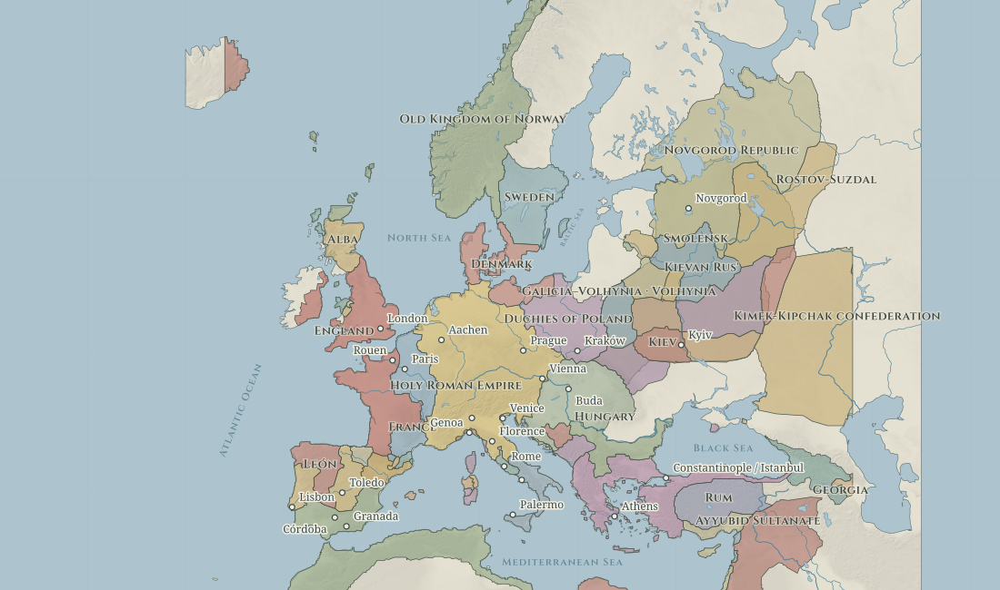

# 欧陆纪年 · Europa Chronica

[](LICENSE)
[](https://joydivisor.github.io/europa-chronica/)
[](https://github.com/Joydivisor/europa-chronica/actions/workflows/pages.yml)

一幅可以拖动时间、点城读史、追随人物足迹的欧洲历史交互舆图。覆盖公元前 **500 年至 2024 年**，支持 **简体中文、繁体中文与 English**。

**[打开地图](https://joydivisor.github.io/europa-chronica/)** · **[Joydivisor 个人主页](https://joydivisor.github.io/)** · **[English introduction](#english)** · **[反馈问题](https://github.com/Joydivisor/europa-chronica/issues)**

> **灵感来源**：本项目受到 [DeanChensj 的《江山时序》（jiangshan-map）](https://github.com/DeanChensj/jiangshan-map) 启发，具体参考范围见[灵感来源与致谢](#灵感来源与致谢)。



## 可以怎样探索

- **沿时间读历史**：连续拖动时间轴、输入年份、播放年代演进，或放大某个时代。公元前纪年自动跳过零年。
- **展开自己的地图**：独立开关地形阴影、河流、湖泊、历史疆域、边线、城市、地名、人物行迹与现代边界。
- **走进城市与政权**：点击地图或图例，站内阅读城市沿革、政权制度、重大事件和对应书目。
- **按地点读编年史**：地点目录按时代筛选城市、会址与战场，事件卡显示日期与地点，详情展开背景、影响和关联史事；多会场事件可逐一定位。
- **随人物行旅**：按年代追随生平节点，也可同时选择多位人物，比较他们的足迹。
- **切换三种语言**：正文、地图、菜单与书目同步切换；当前年份、地点和视角保持不变，分享链接保留语言。
- **试试舆图寻址**：根据五则历史线索在地图上落针，按距离计分。

界面使用羊皮纸、灰蓝海面与低饱和政权色；圆角控件与滑动面板搭配 Noto Serif SC、Cinzel、Uncial Antiqua 和 Cormorant Garamond。

## 从这些时刻开始

| 入口 | 地址 |
| --- | --- |
| 公元 1200 年的欧洲 | [打开地图](https://joydivisor.github.io/europa-chronica/?year=1200) |
| 查理曼在罗马，公元 800 年 | [定位罗马](https://joydivisor.github.io/europa-chronica/?year=800&place=rome) |
| 《大宪章》 | [阅读事件](https://joydivisor.github.io/europa-chronica/?event=magna-carta) |
| 英文界面 | [Explore in English](https://joydivisor.github.io/europa-chronica/?lang=en) |
| 繁體中文 | [開啟輿圖](https://joydivisor.github.io/europa-chronica/?lang=zh-TW) |

键盘：`/` 或 `Ctrl/Cmd + K` 搜索；左右键切换历史节点；`Shift + 左右键` 进退十年；空格播放或暂停。

## 本地运行

纯静态网站，无须地图 API Key、数据库或构建服务。字体、地图与脚本随项目提供。

```sh
git clone https://github.com/Joydivisor/europa-chronica.git
cd europa-chronica
python3 -m http.server 8000 --directory dist
```

打开 **http://localhost:8000**。地图数据通过同源 HTTP 加载，请使用静态服务器访问。

开发与验证使用 Node.js 22：

```sh
npm ci
npm test
```

## 项目结构

```text
dist/
  index.html, style.css, app.js   界面、地图与交互
  data.js                        核心编年史、人物与题目
  content.js                     城市沿革、政权专题与编辑规则
  i18n.js, locales/               三语切换及英文内容
  assets/maps/                   六个时代的历史疆域、来源与修正记录
  assets/geography/              海岸、河流、湖泊与地形阴影
scripts/                         数据检查、交互测试与地理处理脚本
.github/workflows/pages.yml      测试后自动部署 GitHub Pages
```

当前收录 64 则核心史事、73 个地点、24 份城市专题沿革、27 份政权专题、8 位人物生平与 5 道寻址题。城市纪事同时汇入编年史，并保留逐条来源关联。新增 36 条史事覆盖六个时代，包含正文、历史背景与后续影响。

## 历史与地理来源

历史条目引用博物馆、国家档案馆、大学、学术出版物和官方历史文献。来源记录随内容分发，也可在站内资料馆与条目末尾查看。

- **历史疆域**：Cliopatria v0.2.1 的欧洲衍生数据，7,623 条上游合并记录，按六个时代分区。由原始几何重新裁切、简化至 0.007°，保留五位坐标小数；35 组原有合并记录恢复区间内的不同几何。详见 [地图来源与方法](dist/assets/maps/README.md)。
- **自然地理**：Natural Earth **1:10 million** 陆地、河流与湖泊，扩展西侧范围以完整显示冰岛。地形阴影使用 NOAA ETOPO1 / USGS GMTED2010，经 Mapzen / Tilezen Terrarium 分发。详见 [地理图层说明](dist/assets/geography/README.md)。
- **地点核查**：区分城市参考点、遗址范围、战场范围与具体会场，另列事件定位。1789 年的凡尔赛与巴黎、1945 年的兰斯与柏林分别标注。核对记录见 [地理审计](docs/geographic-audit.md) 与 [历史增补来源](docs/history-evidence-audit.md)。
- **冰岛分期**：按议会、政府和外交文献单独修正 930、1262—1264、1814、1918、1944 等节点，并区分战时驻军和主权。方法与来源见 [冰岛显示修正](dist/assets/maps/ICELAND.md)。
- **表示方式**：历史疆域采用学术重建区间；自然地理采用现代参考数据。来源中的时间范围、争议与重建方法保存在对应数据说明中。

`npm test` 检查史源关联、年代、唯一标识、坐标、分段几何、资源 SHA-256 与播放键默认对比度，并覆盖时间轴、图层、三语正文、地点目录、多会场定位、人物行程、寻址游戏和菜单动画状态。

可选的地理重建脚本需要 Python、Shapely 2、NumPy 与 Pillow。缓存默认为 `.cache/geography/`，可用 `EUROPA_DATA_CACHE` 指定位置；重建会下载公开源文件并更新资源与元数据。日常运行和部署直接使用已提交的数据，无须重建。

## 部署

仓库的 **Settings → Pages → Source** 使用 **GitHub Actions**。推送到 `main` 后，工作流安装测试依赖、运行验证，再将 `dist/` 发布到：

**https://joydivisor.github.io/europa-chronica/**

Fork 部署时，在自己的仓库启用 Pages，并将首页、canonical 与 README 地址改为对应的 `https://用户名.github.io/仓库名/`。所有运行时资源采用相对路径，支持项目子目录。

## 灵感来源与致谢

本项目的主要产品与交互灵感来自 **[江山时序（jiangshan-map）](https://github.com/DeanChensj/jiangshan-map)**，作者为 **[DeanChensj](https://github.com/DeanChensj)**。尤其参考了以地图为主体、底部时间轴与侧栏联动的阅读布局，以及拖动年代、点击地点读历史、沿人物足迹探索和切换图层的交互思路。感谢原作者对历史地图探索方式的实践与分享。

**欧陆纪年是独立维护的欧洲历史项目。** 本项目围绕欧洲通史重新整理史事与地点，并实现相应的地图数据处理、三语内容和中古欧洲风格界面；视觉配色也参考了《欧陆风云》（Europa Universalis）系列的历史地图氛围。上述产品、交互与视觉参考在此明确致谢。

实际使用的历史疆域、自然地理、字体及代码依赖，另按各自来源和许可列于[历史与地理来源](#历史与地理来源)及 [THIRD_PARTY_NOTICES.md](THIRD_PARTY_NOTICES.md)。涉及具体代码、数据或素材的复用，应保留相应许可证、署名和修改说明。如发现来源或署名遗漏，欢迎通过 [Issues](https://github.com/Joydivisor/europa-chronica/issues) 提供原始链接与涉及的文件，便于核实和更正。

## 开源与参与

本项目原创程序、界面与文档采用 **GNU General Public License v3.0 only（GPL-3.0-only）**。完整条款见 [LICENSE](LICENSE)。修改和再分发请遵循 GPL-3.0；第三方代码、地图数据与字体保留原有许可证，详见 [THIRD_PARTY_NOTICES.md](THIRD_PARTY_NOTICES.md)。

欢迎通过 [Issues](https://github.com/Joydivisor/europa-chronica/issues) 和 Pull Requests 提交建议；历史内容与翻译贡献请参阅 [CONTRIBUTING.md](CONTRIBUTING.md)。

## English

**Europa Chronica** is an interactive historical atlas of Europe, covering **500 BCE–2024 CE**. Explore political territories, terrain and waterways, follow people through their lives, and read city histories and polity dossiers without leaving the map.

The interface and historical content are available in Simplified Chinese, Traditional Chinese and English. Language changes preserve the current year, place and map view. The atlas is a static application built with JavaScript and D3, with locally hosted fonts and geographic assets.

**Inspiration and acknowledgements:** The main product and interaction inspiration comes from [Chronicles of the Realm / 江山时序 (`jiangshan-map`)](https://github.com/DeanChensj/jiangshan-map) by [DeanChensj](https://github.com/DeanChensj), particularly its map-centred layout, linked timeline and reading panel, place histories, biographical journeys and layer controls. We gratefully acknowledge this influence. The visual palette also takes inspiration from the *Europa Universalis* series.

Europa Chronica is maintained independently, with European historical content, geographic data processing and a multilingual interface developed for this project. Geographic datasets, fonts and libraries are credited separately in [THIRD_PARTY_NOTICES.md](THIRD_PARTY_NOTICES.md), with their respective licences and attribution requirements. Please report missing credits through [Issues](https://github.com/Joydivisor/europa-chronica/issues), including the original source and the relevant files.

- **Live atlas:** https://joydivisor.github.io/europa-chronica/?lang=en
- **Portfolio:** https://joydivisor.github.io/
- **Run locally:** `python3 -m http.server 8000 --directory dist`
- **Validate:** `npm ci && npm test` with Node.js 22
- **License:** GPL-3.0-only for original code and documentation; third-party materials retain their respective licenses.

Copyright © 2026 Joydivisor and contributors.
